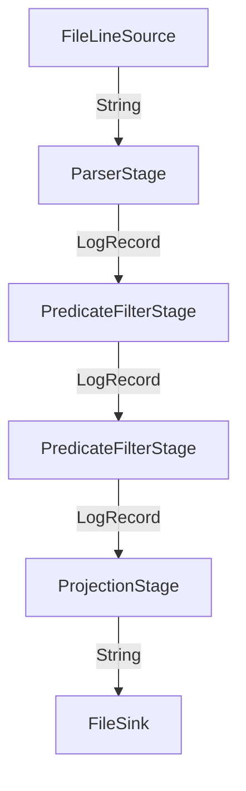

# LogFlow Mimarisi

## Genel bakış

LogFlow, log kayıtlarını birbirinden bağımsız ve
birleştirilebilir aşamalar üzerinden işler.



Her aşama yalnızca kendi görevinden sorumludur.
Aşamalar `Emitter` üzerinden sonraki bileşene veri iletir.

## Bileşenler

| Bileşen | Sorumluluk |
| --- | --- |
| Source<O> | Veri üretme sözleşmesi |
| Stage<I,O> | Girdiyi işleyip sıfır, bir veya daha fazla çıktı üretme |
| Emitter<T> | Çıktıyı sonraki bileşene iletme |
| Sink<I> | Son çıktıyı tüketme |
| FileLineSource | UTF-8 dosyayı satır satır okuma |
| ParserStage | String girdiyi LogRecord nesnesine dönüştürme |
| PredicateFilterStage | Predicate koşulunu sağlayan kayıtları iletme |
| ProjectionStage | Yalnızca seçilen alanları String çıktıya dönüştürme |
| FileSink | Sonuçları UTF-8 çıktı dosyasına yazma |
| Pipeline | Aşamaları çalıştırma ve yaşam döngüsünü yönetme |
| PipelineBuilder | Akıcı biçimde pipeline oluşturma |
| CommandLineOptions | Komut satırı seçeneklerini ayrıştırma |
| Main | Seçeneklere göre bileşenleri birleştirme |

## Bileşilebilirlik

`PredicateFilterStage`, filtre koşulunun kendisini bilmez.
Koşul constructor üzerinden `Predicate<LogRecord>` olarak verilir.

Aynı sınıf aşağıdaki filtrelerin tümünü oluşturabilir:

```java
log -> log.status() >= 400
log -> log.path().startsWith("/api")
log -> !log.timestamp().isBefore(start)
       && log.timestamp().isBefore(end)
```

Koşul sağlanırsa kayıt emit edilir. Sağlanmazsa aşama
çıktı üretmez ve kayıt pipeline'dan elenir.

Aşamalar `PipelineBuilder.via()` ile istenen sayıda
birleştirilebilir:

```java
PipelineBuilder.from(new FileLineSource(input))
        .via(new ParserStage())
        .via(new PredicateFilterStage(
                log -> log.status() >= 400
        ))
        .via(new PredicateFilterStage(
                log -> log.path().startsWith("/api")
        ))
        .via(new ProjectionStage(
                "timestamp", "clientIp", "status"
        ))
        .to(new FileSink(output))
        .run();
```

Generik türler aşamalar arasındaki veri türlerini denetler.
`ParserStage`, `String` alıp `LogRecord` üretir.
`ProjectionStage`, `LogRecord` alıp `String` üretir.

## Filtre ve dönüşüm ilişkisi

`PredicateFilterStage` bir kaydı değiştirmeden iletir veya eler.
Bu nedenle bir girdiden sıfır ya da bir çıktı üretir.

`ProjectionStage` her kaydı seçilen alanlarla yeni bir metin
çıktısına dönüştürür. Bir girdiden bir çıktı üretir.

İkisi de aynı `Stage<I,O>` mimari sözleşmesini kullanır.
Davranışları farklı olsa da pipeline açısından ikisi de
birer aşamadır.

## Veri minimizasyonu

ProjectionStage yalnızca `--fields` ile seçilen alanları
çıktıya ekler. Örneğin:

```text
--fields timestamp,clientIp,status
```

kullanıldığında `raw`, `userAgent`, `bytes` ve `path`
alanları çıktı dosyasına yazılmaz.

Bu yaklaşım çıktı boyutunu azaltır ve ihtiyaç duyulmayan
bilgilerin paylaşılmasını önler.

Bu uygulamada projeksiyonun çıktısı `String` olduğu için
`LogRecord` kullanan filtreler projeksiyondan önce çalışır.
Projeksiyon filtrelerden önce uygulanacaksa sonraki filtrenin
ihtiyaç duyduğu alanların korunması ve farklı bir ara veri
modeli kullanılması gerekir.

## Yaşam döngüsü

Pipeline çalıştırılırken:

1. Aşamaların `open()` metotları çağrılır.
2. Sink'in `open()` metodu çağrılır.
3. Kayıtlar işlenir.
4. Sink'in `close()` metodu çağrılır.
5. Aşamaların `close()` metotları ters sırada çağrılır.

Kapatma işlemleri `finally` bloğunda yürütülür.
Bu nedenle işleme sırasında hata oluşsa bile FileSink
kapatılmaya çalışılır.

FileSink, `open()` sırasında BufferedWriter oluşturur.
`consume()` her çıktıyı ayrı satıra yazar.
`close()` writer'ı kapatarak arabellekteki verileri diske aktarır.

## Komut satırı yapılandırması

Program aşağıdaki biçimde çalıştırılır:

```bash
./logflow <girdi> <cikti> \
--min-status 400 \
--path-prefix /api \
--fields timestamp,clientIp,status
```

`--min-status` ve `--path-prefix` isteğe bağlıdır.
Verilen her filtre pipeline'a ayrı bir
PredicateFilterStage olarak eklenir.

`--fields` verilmezse varsayılan alanlar şunlardır:

```text
timestamp,clientIp,status,path
```

## Filtre sıralaması deneyi

Deney `data/access-small.log` içindeki 200 kayıt üzerinde
iki filtre sırası kullanılarak gerçekleştirilmiştir:

- Status filtresi: `status >= 400`
- Path filtresi: `path startsWith "/page/1"`

### Birinci sıra

```text
Parser → Status filtresi → Path filtresi → Projection
```

- Status filtresi 200 kaydı kontrol etti.
- Status filtresinden 20 kayıt geçti.
- Path filtresi 20 kaydı kontrol etti.
- Toplam koşul kontrolü: 220.

### İkinci sıra

```text
Parser → Path filtresi → Status filtresi → Projection
```

- Path filtresi 200 kaydı kontrol etti.
- Path filtresinden 111 kayıt geçti.
- Status filtresi 111 kaydı kontrol etti.
- Toplam koşul kontrolü: 311.

Her iki sıralama da aynı 11 kaydı ve aynı sıradaki çıktıyı
üretti. Ancak daha seçici olan status filtresini önce
çalıştırmak 91 daha az koşul kontrolü gerektirdi.

Bu sonuç filtreler mantıksal olarak bağımsız olduğunda
sıralamanın sonucu değiştirmediğini, fakat yapılan işi
ve performansı değiştirebildiğini göstermektedir.

Ayrıştırma işlemi filtrelerden önce yapılmalıdır çünkü
status, path ve timestamp alanları ham String üzerinde
tipli alanlar olarak bulunmaz.

## Test yaklaşımı

Her yeni bileşen ayrı test edilmiştir:

- PredicateFilterStage: status, path ve timestamp koşulları
- ProjectionStage: alan seçimi, sıralama ve bilinmeyen alan
- FileSink: açma, yazma, klasör oluşturma ve kapatma
- PipelineIntegrationTest: fixture üzerinde Parser,
  PredicateFilter ve Projection aşamalarının birlikte çalışması
- FilterOrderExperimentTest: iki filtre sırasının çıktısını
  ve koşul kontrol sayılarını karşılaştırma

Testler JUnit 5 ile çalıştırılır ve JaCoCo kapsam raporu
Maven tarafından oluşturulur.